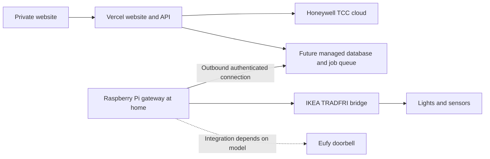

# Home automation roadmap

## Intended architecture

The website is accessible remotely through Vercel. The Pi stays on at home and
handles devices that cannot be reached directly from a cloud function. Prefer an
authenticated outbound connection from the Pi to the cloud, avoiding publicly
exposing the Pi or a device bridge. A private remote-access tunnel can provide
maintenance access later. Device access must not depend on a browser staying open.

## Devices

| Device | Planned role | Integration considerations |
| --- | --- | --- |
| Honeywell Evohome | Heating zones and temperatures | First milestone uses the TCC Europe/UK cloud API. Reading only; controls and rules follow after a verified live connection. |
| Raspberry Pi 2B+ (model to confirm) | Always-on local device gateway | Confirm model, supported OS, memory and storage before selecting a lightweight worker. It should reconnect after outages and authenticate outbound requests. |
| IKEA TRADFRI bridge, lights and sensors | Lighting and local sensor events | Adapter runs on the Pi. Confirm the exact bridge and device models; TRADFRI and DIRIGERA have different APIs. Sensor events may require a different supported Zigbee path. |
| Eufy doorbell | Doorbell events and optional camera features | Confirm the model, HomeBase requirements and available integration. Cloud/local support varies; avoid promising direct Vercel access or unofficial API reliability. |

## Milestones

1. Deploy the private dashboard and verify Evohome readings with the owner's TCC
   account. Keep demo data clearly separated from live readings.
2. Add durable storage, secret/token management, account-wide rate limiting and
   authenticated scheduled jobs before enabling heating automations.
3. Prepare the Pi gateway, register it with the backend, and add reconnect and
   offline reporting. Verify remote access without opening a public router port.
4. Integrate the IKEA bridge and a representative light, then confirm sensor
   support. Define simple rules with execution logs and manual overrides.
5. Integrate the Eufy doorbell after checking model compatibility. Add doorbell
   events before attempting live video, which may require a separate streaming
   service.

Vercel hosts the website and request-driven cloud API. Use its supported scheduler
for suitable timed work, or an external durable worker/queue for persistent
connections and longer jobs. Check current plan limits before selecting schedules.
No automations are enabled in this initial implementation.
